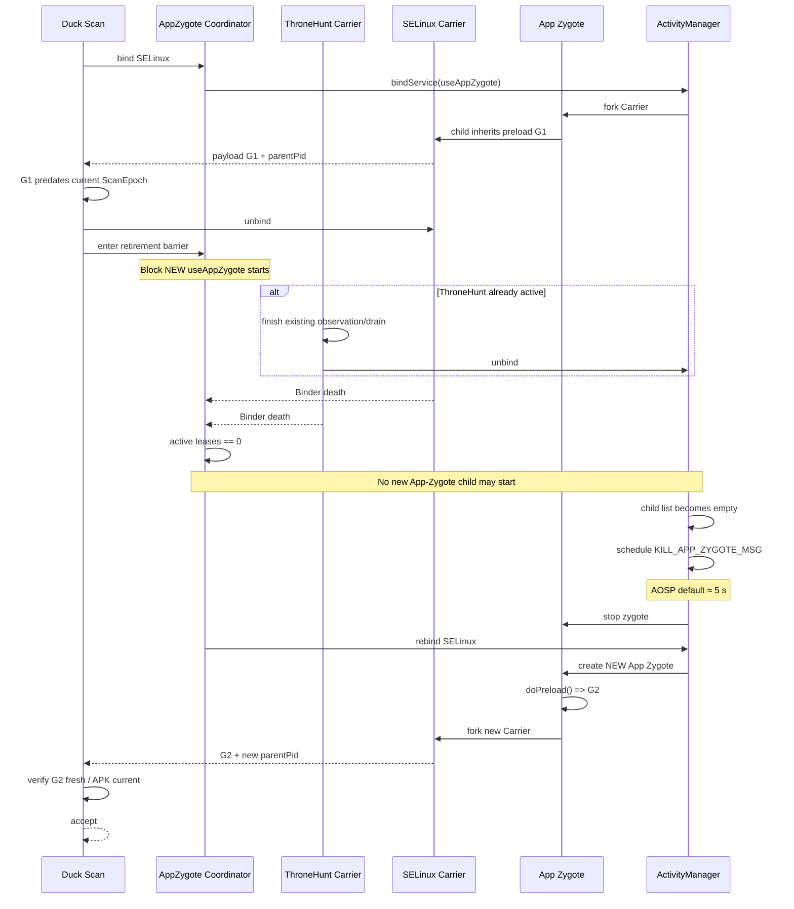

# Duck App Zygote 旧 preload 复用与恢复机制研究报告

## 执行摘要

本轮重新从 **Duck 本地源码、DirtySepolicy 本地源码、fuxi 实机日志、AOSP `frameworks/base` / `system/sepolicy`、Android Common Kernel/GKI** 串了一遍完整调用链。结论比前几轮更明确：

**Duck 现在其实把“正确性保护”做对了一半，但“恢复手段”选错了。**

第一，**旧 preload 复用是真实存在的，而不是理论问题。** fuxi 日志已经直接证明：新的 Carrier PID `13168` 的父进程仍是旧 App Zygote `12379`，Carrier 继承的 preload origin 也是 `12379`，APK 路径虽然完全匹配，但 `startedNanos` 属于上一轮扫描，因此 Duck 正确判出了 `STALE_PRELOAD`。本地证据位于 `/home/xiaotong/download/duck-fuxi-carrier-20261028.log`，10:08:39.888–10:08:39.964。

第二，**`Os.kill(pid, 0)` 不能作为普通 Android App 观察 App Zygote 存活状态的可靠接口。** GKI 的 `kill(2)` 路径即使信号为 0，仍然走 `check_kill_permission()` → `security_task_kill()`；SELinux 将信号 0 映射成 `PROCESS__SIGNULL`。fuxi 恰好产生了：

```text
avc: denied { signull }
scontext=u:r:untrusted_app:s0:...
tcontext=u:r:app_zygote:s0:c512,c768
tclass=process
```

所以这是**设计上会受 SELinux policy 约束**的接口，不是“不会发送信号所以天然安全可查询”的无权限存在性探针。GKI 对 null signal 的实现就是“权限和进程存在性探测，但不实际送信号”；权限检查本身仍然存在。第三，**DirtySepolicy 没表现出 Duck 现在这个错误，并不意味着它解决了旧 preload。恰恰相反，它没有检测旧 preload。** DirtySepolicy 的 App Zygote 在 `doPreload()` 里写静态 `AppZygote.result`，隔离 Service 的 `getResult()` 原样返回它；源码没有 scan generation、preload 时间、APK generation 或父 PID 新鲜度验证。因此 App Zygote 被复用时，从源码机制上看，它可以静默返回上一代结果。Duck 则把这种情况显式变成了失败。

第四，**AOSP 本身已经给了我们一个不需要观察父 PID 的恢复依据。** App Zygote 的最后一个子进程从 `ProcessList` 的 child list 移除后，ActivityManager 默认安排一个约 **5 秒**后的 `KILL_APP_ZYGOTE_MSG`；如果期间又启动依赖同一 App Zygote 的进程，现有 App Zygote 会被复用，待回收消息也会被取消。因此，**最推荐的应用侧方案不是继续寻找一个“能不能看到父 PID”的 hack，而是建立真正的 App Zygote retirement barrier：**

> 发现旧 preload → 释放 stale Carrier → 禁止任何新的 `useAppZygote` bind → 允许已经存在的 ThroneHunt 正常完成 → 确认所有 Duck App-Zygote 子进程都已经死亡 → 从“最后一个子进程死亡”开始等待 AOSP 的 5 秒回收窗口 + 安全余量 → 再 bind → 最后用 preload generation/父 PID/时间戳严格验证。

**整个过程中不需要 `kill(pid,0)`。**

Duck 甚至已经有一半基础设施：`AppZygoteStartGate` 有 `acquireLease()` 和 `awaitNoActiveLeases()`，但我全仓搜索后确认，**这两个 API 目前没有任何实际调用方**。因此当前代码并不知道 ThroneHunt/Selinux Carrier 什么时候真正把 App Zygote 的最后一个子进程释放掉。这正是应当补齐的核心。

我建议形成两级恢复：

| 层级 | 方案 | 推荐度 |
|---|---|---:|
| 主路径 | **全局 retirement barrier + Binder child-death + AOSP 5s quiet window + 重绑后严格验鲜** | **最高** |
| 加速路径 | **`pidfd_open()` + `poll()` 直接观察旧 App Zygote 退出；失败自动退回主路径** | 高，但先实机验证 |
| 安全兜底 | **持久化 preload generation fence，任何情况下绝不重复接受同一 preload generation** | 高，建议同时做 |
| 系统方案 | system_server 调 `killAppZygotesLocked(..., force=true)` | 最确定，但需要 ROM/特权改动 |

这些方案共同遵守一个原则：

> **“恢复失败”可以暂时得到 `UNAVAILABLE`；绝不能为了成功率重新接受旧 preload。**

本轮 `/home/xiaotong/Duck-Detector-Refactoring`、`/home/xiaotong/DirtySepolicy` 和 fuxi 日志均可读取；你指定的 `/mnt/c` 被当前 DevSpace 沙箱明确拒绝为 `Path is outside allowed roots`，因此本报告没有声称检查了 `/mnt/c`。fuxi 的精确内核源码、vendor sepolicy 和 kernel config 也未提供，所以 GKI 部分采用官方 Android Common Kernel `android15-6.6` 作为参考基线；这不是在断言 fuxi 一定运行该分支。Android 官方把 `android15-6.6` 列为对应的 GKI/ACK 系列之一。## 问题定位与本地证据

### Duck 的旧 preload 到底是怎么被重复用的

AOSP 的 `AppZygoteInit.handlePreloadApp()` 会根据 `ApplicationInfo` 创建 `LoadedApk`、取得应用 ClassLoader，实例化 manifest 指定的 `ZygotePreload`，然后调用一次 `doPreload(appInfo)`。这发生在 **App Zygote 自身初始化阶段**，不是每次 isolated service 被 bind 时重新执行。Duck 对应入口是：

```text
/home/xiaotong/Duck-Detector-Refactoring/
sdk/runtime/src/main/kotlin/
com/eltavine/duckdetector/sdk/DuckDetectorZygotePreload.kt
```

当前逻辑：

```kotlin
override fun doPreload(appInfo: ApplicationInfo) {
    trace("preload entry pid=${Os.getpid()} ...")
    val selinuxContextValidity = SelinuxContextValidityPreload()

    selinuxContextValidity.preload(appInfo, trace = ::trace) {
        DetectorCatalog.all.forEach { detector ->
            detector.appZygotePreload(appInfo)
        }
    }

    trace("preload finished")
}
```

而 `SelinuxContextValidityPreload.kt:41–149` 会在 App Zygote 中采样，并把结果连同 provenance 塞进进程静态数据：

```kotlin
val preloadStartedNanos = SystemClock.elapsedRealtimeNanos()

...

SelinuxContextValidityBridge.setPreloadedRawData(
    SelinuxCarrierProvenanceCodec.attach(
        payload,
        SelinuxCarrierProvenance(
            preloadPid = Os.getpid(),
            appUid = appInfo.uid,
            startedNanos = preloadStartedNanos,
            apkPath = appInfo.sourceDir.orEmpty(),
            splitPaths = appInfo.splitSourceDirs?.toList().orEmpty(),
        ),
    ),
)
```

AOSP 后续启动 `useAppZygote` isolated process 时，是从这个 `AppZygote` fork 子进程；`ProcessList` 会找到或创建相应 `AppZygote`，然后通过该 App Zygote 的 zygote connection 启动子进程。因此当前数据关系实际上是：

```text
App Zygote PID 12379
    |
    | doPreload() 只执行一次
    |
    +-- static preload payload = generation G1
    |
    +-- fork Carrier A
    |      -> 继承 G1
    |
    +-- fork Carrier B
    |      -> 仍然继承 G1
    |
    +-- fork 下一轮 Carrier C
           -> 如果父进程仍存活，依然继承 G1
```

由 fork 的进程内存语义还可以进一步推断：即使 Carrier 子进程“消费后清空”自己的静态字段，这个写操作也不会反向修改 App Zygote 父进程原先持有的 payload；下一个 fork 仍可以从父进程重新获得旧值。AOSP 的关键事实是 Carrier 是从存活的 App Zygote 再次 fork，而不是重新执行 `doPreload()`。### fuxi 已经把这条链完全跑出来了

fuxi 日志第一次明确复现：

```text
10:08:34.072 DuckZygotePreload:
preload entry pid=12379 ...

10:08:34.456 DuckZygotePreload:
preload finished
```

然后 Duck 主进程很快重新起来：

```text
10:08:38.657 am_proc_start:
pid=12817 ... com.eltavine.duckdetector
```

新扫描 bind SELinux Carrier：

```text
10:08:39.888 DuckSelinuxCarrier:
service pid=13168 ppid=12379 ...

10:08:39.920 DuckSelinuxCarrier:
preload payload cached=false present=true

10:08:39.923 DuckSelinuxCarrier:
preload origin pid=12379
...
verified=true
```

最关键的是：

```text
10:08:39.964 DuckSelinuxCarrier:
snapshot preload pid=12379 ...
freshness=App Zygote preload belongs to an earlier scan.
```

这说明：

**新 Carrier = `13168`**

但：

**父 App Zygote = 旧的 `12379`**

并且：

**preload generation = `12379` 启动时留下的旧 generation**

所以 Duck 的 freshness check 本身是正确的。

当前恢复代码随后：

```text
10:08:40.000 waiting for old App Zygote pid=12379 to exit
10:08:40.000 old App Zygote pid=12379 exited=false
10:08:40.001 ... available=false ...
```

而同一位置紧跟着 SELinux AVC：

```text
avc: denied { signull }
scontext=u:r:untrusted_app:s0:c239,c258,c512,c768
tcontext=u:r:app_zygote:s0:c512,c768
tclass=process
permissive=0
```

本地日志位置：

```text
/home/xiaotong/download/duck-fuxi-carrier-20261028.log
```

其中 grep 定位的关键行为在约 L190–L192。

更值得注意的是，Duck 声称：

```text
App Zygote parent did not exit before recovery deadline.
```

但从日志看并没有等 23 秒，而是在约 **1 ms** 内就结束。这和当前 `SelinuxAppZygoteRecovery.kt:58–87` 的逻辑一致：

```kotlin
fun parentAlive(pid: Int): Boolean? {
    return try {
        Os.kill(pid, 0)
        true
    } catch (error: ErrnoException) {
        when (error.errno) {
            OsConstants.ESRCH -> false
            OsConstants.EPERM -> true
            else -> null
        }
    } catch (_: SecurityException) {
        null
    }
}

suspend fun awaitParentExit(...): Boolean {
    while (true) {
        when (probe(pid)) {
            false -> return true
            null -> return false
            true -> delay(intervalMs)
        }
    }
}
```

也就是说当前错误提示本身还不精确：**“无法观察父进程”被错误包装成了“等待截止前没有退出”。**

### DirtySepolicy 为什么看起来没这个问题

DirtySepolicy 本地源码是非常直接的：

```text
/home/xiaotong/DirtySepolicy/
app/src/main/java/org/lsposed/dirtysepolicy/AppZygote.java
```

其中：

```java
static String result = "ERROR: app zygote not called";

@Override
public void doPreload(ApplicationInfo appInfo) {
    ...
    result = "OK: no dirty sepolicy found";
}
```

然后：

```text
app/src/main/java/org/lsposed/dirtysepolicy/DirtySepolicyService.java
```

只有：

```java
@Override
public String getResult() {
    return AppZygote.result;
}
```

两者的区别可以概括为：

| 行为 | DirtySepolicy | Duck |
|---|---|---|
| `doPreload()` 数据存储 | App Zygote static `result` | App Zygote static encoded payload |
| 每次 Service bind 是否重新 preload | 否 | 否 |
| preload PID | 不验证 | 验证 |
| APK generation | 不验证 | source/split 路径验证 |
| scan generation | 没有 | `ScanEpoch` |
| preload 时间 | 没有 | `startedNanos` |
| 跨扫描旧结果 | **可能静默接受** | **显式拒绝** |
| 旧结果后的恢复 | 没有 | 当前尝试 `kill(pid,0)` |

所以“DirtySepolicy 没这个问题”更准确的表述应该是：

> **DirtySepolicy 没有 Duck 当前这个显式 `UNAVAILABLE`，因为它没有检测 stale generation。**

从源码本身不能证明它在 fuxi 上“每次都重新采样”；相反，AOSP 的 App Zygote 复用机制意味着它存在复用同一个 `result` 的机制条件。要证明它在 fuxi 上实际是否返回旧结果，还需要给 DirtySepolicy 加上 preload PID/timestamp 日志做一次对照实验。

## AOSP 与 GKI 源码证据

### App Zygote 创建和复用

AOSP master 的 `ProcessList.createAppZygoteForProcessIfNeeded()` 首先使用进程信息和 defining UID 查询 `mAppZygotes`；如果已经存在，就复用；只有找不到时才创建新的 `AppZygote`、分配 isolated UID range 并加入映射。之后具体业务进程由该 App Zygote 启动。这里有一个值得纠正的细节：

**从 AOSP 实现看，它并不是抽象意义上的“整个包永远只有一个 App Zygote”，实际缓存键涉及 process name 与 defining UID。**

但 Duck 当前两个 `useAppZygote` Carrier 没有为 App Zygote 建立不同的 defining process generation；fuxi 实际日志也已经证明至少 SELinux Carrier 与此前的 Duck App Zygote发生了复用。

Duck Manifest 中当前至少有两个 App-Zygote Carrier：

```xml
<!-- capability/selinuxpolicy/data/src/main/AndroidManifest.xml -->
<service
    android:name="...SelinuxContextValidityCarrierService"
    android:isolatedProcess="true"
    android:useAppZygote="true" />
```

以及：

```xml
<!-- feature/nativeroot/data/src/main/AndroidManifest.xml -->
<service
    android:name="...ThroneHuntCarrierService"
    android:isolatedProcess="true"
    android:useAppZygote="true" />
```

其中 ThroneHunt 还**有意保持 Service 连接覆盖整轮约 13 秒 oracle 窗口**：

```kotlin
// The connection is held for the whole oracle round.
private var activeConnection: ServiceConnection? = null
private var activeProxy: ThroneHuntCarrierProxy? = null
```

因此 SELinux Carrier 自己 unbind 并不能推出：

```text
App Zygote child count == 0
```

这对正确恢复至关重要。

### 回收时机不是从 preload 完成开始

AOSP `ProcessList.removeProcessFromAppZygoteLocked()` 的逻辑是：从 App Zygote 的 child process 集合中移除死亡子进程；只有集合变空时才考虑回收。正常场景不是立即 stop，而是向 ActivityManager handler 投递延迟的 `KILL_APP_ZYGOTE_MSG`。AOSP 当前定义：

```java
static final int KILL_APP_ZYGOTE_DELAY_MS = 5 * 1000;
```

其语义就是最后一个使用该 App Zygote 的进程消失后，等待一段时间再杀 App Zygote。所以计时起点必须理解成：

```text
最后一个 App Zygote child 被 AMS 移除
        |
        + 5 秒
        |
        v
尝试回收 App Zygote
```

而不是：

```text
doPreload() 完成
        |
        + 5 秒
```

这也解释了为什么此前“从 preload 后固定等 6.5 秒”的方案理论上就是错的。

更关键的是：如果在等待期间又启动一个依赖该 App Zygote 的进程，`ProcessList` 会找到现有 App Zygote 并复用它；AOSP 还会取消对应的待回收行为。这直接暴露了 Duck **当前恢复算法的第二个问题**：

```kotlin
// Do not occupy the start gate while waiting:
SelinuxAppZygoteRecovery.recover(...)
```

这段设计的初衷是“别阻塞 ThroneHunt”，但它把两类行为混在了一起：

- **已经连接的 ThroneHunt 应该允许继续完成。**
- **新的 App-Zygote bind 在 retirement window 内绝不能允许启动。**

当前代码是把整个 start gate 放开了，于是“等待回收”期间仍可能出现一个新的 `useAppZygote` bind，而这个 bind 恰好会让 AMS 继续保留旧 App Zygote。

正确设计应该是：

> **阻止新 bind，但不阻止已经存在的 Binder proxy 继续工作和自行结束。**

### App Zygote preload 的执行时机

`AppZygoteInit.handlePreloadApp()` 通过应用 ClassLoader 实例化 `ZygotePreload` 实现，然后调用 `doPreload(appInfo)`；这是 App Zygote 的 preload 生命周期阶段。之后该 App Zygote进入 child zygote server。因此不应该设计一个“重新 bind 同一个 App Zygote，期望 AOSP 自动再次执行 `doPreload()`”的恢复逻辑。

恢复的必要条件是：

```text
旧 App Zygote generation 消失
        ↓
下一次 bind 无现有 zygote 可复用
        ↓
AMS 创建新 App Zygote
        ↓
AppZygoteInit.handlePreloadApp()
        ↓
新的 DuckDetectorZygotePreload.doPreload()
```

这就是 Duck 的真正 freshness boundary。

### 为什么 `kill(pid,0)` 会被 SELinux 拒绝

Android Common Kernel/GKI 的 `kernel/signal.c` 中，发送 signal 的入口会先调用 `check_kill_permission()`。credential 层首先检查 UID 或 `CAP_KILL`；即使这一层满足，后面仍然调用 LSM：

```text
security_task_kill(...)
```

而 signal=0 并不会绕开这个检查。实际只是不进入真正 signal delivery。对应 GKI SELinux hook `selinux_task_kill()` 明确把 signal 0 映射为：

```text
PROCESS__SIGNULL
```

然后调用 SELinux AVC 权限检查。所以完整调用链是：

```text
Duck untrusted_app
    |
    | Os.kill(appZygotePid, 0)
    v
bionic kill()
    |
    v
GKI do/kill path
    |
    v
check_kill_permission()
    |
    +--> UID / CAP_KILL check
    |
    v
security_task_kill()
    |
    v
selinux_task_kill()
    |
    | sig == 0
    v
PROCESS__SIGNULL
    |
    v
avc_has_perm(untrusted_app -> app_zygote)
    |
    X denied
```

fuxi 的 AVC 与这条源码路径逐项吻合。

特别是：App Zygote 的 UID 与普通应用 UID 可以相同，但 **Linux DAC UID 相同不等于 SELinux domain 相同**。fuxi 中就是：

```text
source = untrusted_app
target = app_zygote
```

Android sepolicy 反过来明确给 `system_server` 管理 zygote/app_zygote 所需的 `sigkill/signull` 等 process 权限；这也符合“App Zygote 生命周期由 system_server 管，而不是应用自己通过 signal 管”的架构。### `/proc`、`ps`、pidfd 和 Binder 的可行性对比

Android init 当前仍以：

```text
hidepid=2,gid=AID_READPROC
```

挂载 `/proc`，目的就是限制非授权进程观察其他进程。因此下面这些方法不应该成为 Duck 的正确性基础：

| 方法 | 结论 | 原因 |
|---|---|---|
| `/proc/$pid` 是否存在 | 不推荐作为主路径 | hidepid、SELinux/OEM 策略、PID reuse |
| `/proc/$pid/stat` | 可做诊断，不宜做跨设备 correctness contract | 仍受 proc visibility；数值 PID 可复用 |
| app 内执行 `ps` | 不解决问题 | 最终仍依赖 `/proc` 可见性 |
| `ActivityManager.getRunningAppProcesses()` | 不可用作 App Zygote liveness | 公共接口没有暴露 AMS 内部 `mAppZygotes` |
| Carrier Binder | **适合观察 Carrier child 死亡** | 已经持有 Binder handle，可用 death notification |
| Carrier `getppid()` | **适合重绑后验证 generation** | 能证明新 child 的真实父 PID，但不能观察旧父死亡 |
| `pidfd_open()` + `poll()` | **很有潜力** | 不使用 signal，能绑定具体 process identity |
| `kill(pid,0)` | **应删除** | `PROCESS__SIGNULL`，fuxi 已实机证明被拒绝 |

Android 15 6.6 GKI 的 `pidfd_open` 路径在 `kernel/pid.c` 中是查找 PID 并创建 pidfd；与 `kill` 不同，这个 syscall 主体没有经过 `security_task_kill()` 的 `SIGNULL` 路径。Android bionic 也提供了 `pidfd_open` syscall wrapper。不过这里必须保持证据等级：

> **我现在把 pidfd 定义为“源码上很强的候选方案”，还不能定义成“fuxi 已确认可用”。**

原因是 fuxi 的 exact kernel/vendor patch、App seccomp filter 和 OEM policy 没有提供。正确做法是在 fuxi 上先跑一个完全无副作用的 `pidfd_open(oldParentPid, 0)` + `poll()` instrumentation probe，记录 errno。若得到 `ENOSYS`、seccomp 拒绝或其他 OEM 限制，自动降级到不依赖 PID observer 的 retirement barrier。

## 替代方案与实施排序

### 推荐方案：全局 retirement barrier，不观察父 PID

这是我认为**最应该落地到正式代码**的方案。

它只依赖 Duck 自己可控的 child lifecycle，加上 AOSP 已定义的 delayed App Zygote retirement 机制；不需要普通应用获得任何新的 SELinux 权限。

核心不变量是：

```text
retirement window 内：
所有已经存在的 App-Zygote child 可以完成，
但绝不允许创建任何新的 App-Zygote child。
```

流程为：

```text
首次 bind
    ↓
拿到 preload
    ↓
fresh ?
 ┌──┴──┐
 yes   no
 │      │
接受   stale Carrier unbind
        ↓
   进入 retirement barrier
        ↓
   阻止任何 NEW useAppZygote bind
        ↓
   等待 ThroneHunt 等已存在 child 完成
        ↓
   等待所有 App-Zygote Carrier Binder death
        ↓
   从最后 child death 起等待 5s + guard
        ↓
   重新 bind 一次
        ↓
   严格验证新的 preload generation
        ↓
 fresh/new parent ? ——否→ UNAVAILABLE
        │
       是
        ↓
      接受
```

为什么这个方案比固定 `delay(6500)` 正确：AOSP 的 5 秒计时点是 child list 变空，而不是 preload 时间；现在我们明确把自己的计时点放在“最后一个已知 App Zygote child 死亡之后”。为什么还需要重绑后的严格校验：Handler 调度并不是普通 App 能获得的实时硬期限，OEM 也可能修改延迟。因此即便等待了 5 秒 + guard，也**不能把“时间到了”当成父进程一定死亡的证明**。最终证明永远是：

```text
replacement.preloadGeneration != staleGeneration
AND replacement.startedNanos >= currentScan.startedNanos
AND APK identity matches
AND replacementParentPid != previousParentPid   // 有旧 PID 时
```

如果还是同一 generation，就再次 unbind，并返回 `UNAVAILABLE` 或最多执行一次更长的 bounded recovery；**绝不能接受旧结果**。

#### Duck 已经存在但没有接上的基础设施

`core/platform/.../AppZygoteStartGate.kt` 已经有：

```kotlin
public fun acquireLease(): Lease

public suspend fun awaitNoActiveLeases(...)
```

但我对整个 Duck 仓库做了搜索，结果只有这两个函数的**定义本身**，没有任何调用。

所以当前代码注释虽然声称：

> tracks a connected child that keeps the shared App Zygote alive

实际上并没有 track 任何 child。

这是现在最应该先修的地方。

#### 所需权限

无需新增权限，无需修改 SELinux，无需 Root，无需 system_server API。

#### 优点

它与 AOSP 生命周期模型直接对应；跨设备不会因为 `signull` 权限不同而失效；不依赖 `/proc` 可见性；并且即使 OEM 的回收延迟不同，最终 generation verification 仍然保证**最多失败，不会误用旧数据**。

#### 缺点

极端情况下需要额外等待 5～若干秒；如果某个 App-Zygote Carrier 泄漏连接，必须超时并报告 `UNAVAILABLE`。若 OEM 完全不按 AOSP 延迟机制回收，恢复成功率会下降，但结果正确性不受影响。

### 可选加速：`pidfd_open()` 精确观察旧父进程

如果 fuxi 实测允许 `pidfd_open()`，这是很适合作为方案一的**加速器**。

流程：

```text
得到 stale parent PID
        ↓
pidfd_open(parentPid, 0)
        ↓
成功?
 ┌──────┴─────┐
yes           no
 │             │
进入 barrier   fallback 方案一
 │
poll(pidfd)
 │
POLLIN/HUP -> 旧 App Zygote 已退出
 │
立即重新 bind
```

相比 `kill(pid,0)`，它有两个关键优势：

**它不是 signal API。** GKI 的 `pidfd_open` 主路径没有走 `security_task_kill()` / `PROCESS__SIGNULL`。**它绑定的是 process identity，而不是只记一个整数 PID。** 因此比周期性查 `/proc/$pid` 更不容易受 PID reuse 影响。

代码建议放一个很窄的 native adapter：

```cpp
enum class PidfdOpenState {
    Opened,
    Unsupported,
    PermissionLimited,
    NotFound,
    Failed,
};

int open_process_pidfd(pid_t pid) {
    return pidfd_open(pid, 0);
}

bool wait_pidfd_exit(int fd, int timeout_ms) {
    pollfd pfd{
        .fd = fd,
        .events = POLLIN | POLLHUP,
        .revents = 0,
    };

    const int rc = poll(&pfd, 1, timeout_ms);
    return rc > 0 && (pfd.revents & (POLLIN | POLLHUP));
}
```

不要使用：

```text
pidfd_send_signal()
```

因为我们根本不需要向 App Zygote 发信号。

#### 所需权限

理论上无需 `process signull`；但 fuxi 上必须实测 seccomp/OEM 可达性。在得到实机结果前应设计成 optional capability，而不是硬依赖。

#### 优点

可以不必保守地完整等待固定 5 秒以上；真正父进程退出时立即继续。还解决了 PID reuse 的观测歧义。

#### 缺点

需要 JNI/native 小接口；不同内核/Android 版本要处理 `ENOSYS` 等；它**仍然不能替代 global barrier**——如果 Duck 在等待期间不断启动新 Carrier，父进程本来就不会退出。

所以正确组合是：

> **barrier 是生命周期正确性；pidfd 是更精确的 liveness observer。**

而不是二选一。

### 安全兜底：持久化 preload generation fence

这是一个简单但非常有价值的 correctness 防线。

当前 freshness 主要是：

```kotlin
origin.startedNanos < scan.startedNanos
```

它已经很有效，但我建议额外生成一个明确的：

```kotlin
data class AppZygoteGeneration(
    val preloadPid: Int,
    val preloadStartedNanos: Long,
    val apkPath: String,
    val splitPaths: List<String>,
    val versionCode: Long,
    val payloadSchemaVersion: Int,
)
```

Duck **成功采用**某个 generation 后，把 generation key 存到主应用持久存储。

下一轮，不论主进程是否重启：

```kotlin
if (origin.generationKey == lastConsumedGeneration) {
    return STALE_PRELOAD
}
```

这样把检测语义明确成：

> 一个 App Zygote preload generation 最多被一个逻辑扫描 generation 接受一次。

例如：

```kotlin
interface AppZygoteGenerationStore {
    fun lastAccepted(): AppZygoteGenerationKey?
    fun commitAccepted(key: AppZygoteGenerationKey)
}

fun validateGeneration(
    origin: SelinuxCarrierProvenance,
    scan: ScanEpoch,
    lastAccepted: AppZygoteGenerationKey?,
): GenerationVerdict {
    val key = origin.toGenerationKey()

    if (key == lastAccepted) {
        return GenerationVerdict.Stale("Preload generation was already consumed.")
    }

    if (origin.startedNanos < scan.startedNanos) {
        return GenerationVerdict.Stale("Preload predates this scan.")
    }

    return GenerationVerdict.Fresh(key)
}
```

成功结果最终 commit：

```kotlin
generationStore.commitAccepted(key)
```

#### 所需权限

无。

#### 优点

极其简单；主进程崩溃/快速重启后仍然记得旧 generation；哪怕其他 recovery 机制全失败，也不会误接受旧结果。

#### 缺点

它是**防错机制而不是重新 preload 的机制**。因此必须和方案一或二组合，否则连续扫描可能得到 `UNAVAILABLE`。

### 系统侧方案：由 ActivityManager 强制杀 App Zygote

AOSP 自己当然能确定性地做这件事。

`ProcessList.killAppZygoteIfNeededLocked()` 在 `force=true` 时可以绕过“仍有 child”的普通条件并停止 App Zygote；AMS 内部存在调用 `killAppZygotesLocked(..., true /* force */)` 的生命周期路径。这就是为什么 system_server 有针对 App Zygote 的 signal/process 权限，而普通 untrusted app 没有。如果 Duck 是 ROM 内建组件，可以设计一个 signature Binder API：

```java
@RequiresPermission("android.permission.MANAGE_APP_ZYGOTE")
void retireAppZygote(String packageName, int userId) {
    synchronized (mGlobalLock) {
        mProcessList.killAppZygotesLocked(
            packageName,
            UserHandle.getAppId(callingUid),
            userId,
            true /* force */
        );
    }
}
```

但这不适合普通 Duck APK：

- 需要 system_server 或 platform-signed privileged component。
- 会影响当前所有共享此 App Zygote 的 Carrier。
- 必须先协调 ThroneHunt 等正在使用的子进程。
- 新增公开/私有 Binder surface 还需要权限和 SELinux 设计。

所以这应该只写在研究结论里，**不应成为 Duck 正常安装版本的依赖**。

## Duck 代码级改造建议

### 建议删掉当前 `kill(pid,0)` recovery

目标文件：

```text
capability/selinuxpolicy/data/src/main/kotlin/
.../SelinuxAppZygoteRecovery.kt
```

删除：

```kotlin
fun parentAlive(pid: Int): Boolean?
suspend fun awaitParentExit(...)
```

以及：

```kotlin
Os.kill(pid, 0)
```

父 PID 仍然保留，但只承担：

```text
preload provenance
+
replacement generation postcondition
```

即：

```kotlin
if (replacementParentPid == previousParentPid) {
    reject("App Zygote generation was reused after retirement attempt.")
}
```

而不是：

```kotlin
while (kill(pid, 0) says alive) ...
```

### 把 `AppZygoteStartGate` 真正升级成生命周期协调器

当前：

```text
core/platform/src/main/kotlin/
com/eltavine/duckdetector/core/platform/AppZygoteStartGate.kt
```

已有：

```kotlin
private val operationMutex = Mutex()
private val activeLeaseCount = AtomicInteger()

fun acquireLease(): Lease
suspend fun awaitNoActiveLeases(...)
```

建议改成类似：

```kotlin
public suspend fun <T> withRetirementBarrier(
    timeoutMs: Long,
    block: suspend RetirementScope.() -> T,
): T = operationMutex.withLock {
    val allChildrenGone = awaitNoActiveLeases(timeoutMs)
    if (!allChildrenGone) {
        throw AppZygoteRetirementException(
            "App Zygote carriers did not retire before deadline."
        )
    }

    RetirementScope(this).block()
}
```

这里最重要的语义不是 API 名字，而是：

```text
operationMutex held
    => 不允许新的 App-Zygote bind

active existing proxies
    => 不受影响，可继续执行事务并 close()

activeLeaseCount == 0
    => 已知所有 Duck App-Zygote children 都结束
```

不要像现在一样“等待期间完全释放 gate”。

### Carrier lease 必须绑定到真实子进程生命周期

SELinux 和 ThroneHunt 都要接。

`ThroneHuntCarrierManager.kt` 是最重要的，因为它故意长期保持 child。

连接成功：

```kotlin
private var activeLease: AppZygoteStartGate.Lease? = null
```

```kotlin
override fun onServiceConnected(
    name: ComponentName?,
    service: IBinder?,
) {
    ...

    val lease = AppZygoteStartGate.Default.acquireLease()

    service.linkToDeath({
        lease.close()
        clearActiveConnection()
    }, 0)

    synchronized(this@ThroneHuntCarrierManager) {
        activeLease = lease
        activeProxy = proxy
        ...
    }
}
```

`close()` 发起 unbind，但**不应该简单地把 unbind 返回当成 child 已经死亡**。

最好让 lease 生命周期锚定：

```text
Binder DeathRecipient
```

因为我们真正关心的是：

```text
isolated process 已经退出
```

而不是：

```text
unbindService() Java 调用已经返回
```

需要有超时兜底；如果 Binder death notification 始终不来，就把 retirement 标成 `UNAVAILABLE`，不能假定 process 已死。

SELinux Carrier 因为生命周期短，也采用同一套 helper，避免两个实现各自猜生命周期。

可以抽成很窄的：

```kotlin
internal class AppZygoteCarrierLease(
    private val gate: AppZygoteStartGate,
) {
    fun attach(binder: IBinder): AutoCloseable { ... }
}
```

不要扩成大而泛的全局 Service 管理器。

### stale recovery 改成“retirement + rebind”

`SelinuxContextValidityCarrierManager.collectSnapshot()` 可以收敛成：

```kotlin
val first = collectOnce(scan)

if (!recovery.shouldRecover(first)) {
    return first.snapshot
}

return AppZygoteStartGate.Default.withRetirementBarrier(
    timeoutMs = EXISTING_CARRIER_DRAIN_TIMEOUT_MS,
) {
    // At this point:
    // 1. stale SELinux binding has already been released
    // 2. existing ThroneHunt is allowed to finish
    // 3. no new App-Zygote service can start
    // 4. all tracked children have died

    retirementWaiter.awaitQuietWindow()

    val replacement = admitExclusive(
        scanStartedAt = scan.startedMillis,
        refused = { failedAttempt(SKIPPED_AFTER_FAILED_START) },
        stoppedBeforeConnecting = CarrierAttempt::stoppedBeforeConnecting,
    ) {
        performRemoteSnapshotCollection(appContext, scan)
    }

    recovery.verifyReplacement(
        previous = first,
        replacement = replacement,
        scan = scan,
    )
}.snapshot
```

`awaitQuietWindow()` 默认实现：

```kotlin
internal class AospDelayedRetirementWaiter(
    private val delayMillis: suspend (Long) -> Unit = { delay(it) },
) {
    suspend fun awaitQuietWindow() {
        // AOSP default is 5 s after last child removal.
        // Guard is deliberately conservative; the replacement is still
        // independently verified and never trusted based on time alone.
        delayMillis(APP_ZYGOTE_KILL_DELAY_MS + SCHEDULING_GUARD_MS)
    }

    companion object {
        const val APP_ZYGOTE_KILL_DELAY_MS = 5_000L
        const val SCHEDULING_GUARD_MS = 1_500L
    }
}
```

这里的 `6500 ms` 和之前完全不是一个设计。

之前是：

```text
发现问题
↓
随便从某个时间点等 6.5 秒
```

现在是：

```text
确认最后一个已知 App-Zygote child 真正死亡
↓
禁止任何新 child
↓
从这个时点开始等 5s + guard
```

AOSP 根据最后一个 child 离开来安排回收，因此后者才对应 framework 的真实生命周期。### 推荐加入 pidfd observer，但作为 capability

接口：

```kotlin
internal interface ProcessRetirementObserver {
    suspend fun awaitExit(
        pid: Int,
        timeoutMs: Long,
    ): ProcessRetirementResult
}

internal sealed interface ProcessRetirementResult {
    data object Exited : ProcessRetirementResult
    data object Unsupported : ProcessRetirementResult
    data object PermissionLimited : ProcessRetirementResult
    data object TimedOut : ProcessRetirementResult
    data class Failed(val errno: Int?) : ProcessRetirementResult
}
```

GKI 支持时：

```kotlin
when (pidfdObserver.awaitExit(previousPid, PIDFD_TIMEOUT_MS)) {
    Exited -> rebindImmediately()

    Unsupported,
    PermissionLimited -> {
        // Do not treat as failure of the SELinux detector.
        // Fall back to AOSP quiet-window recovery.
        quietRetirementWaiter.awaitQuietWindow()
        rebind()
    }

    TimedOut -> unavailable(...)
}
```

这样 fuxi 哪怕不允许 pidfd，仍不会回到 `kill(0)`。

### provenance 再增加 APK build generation

当前：

```kotlin
appUid
apkPath
splitPaths
startedNanos
preloadPid
```

已经不错，但为了“APK 更新”这个具体需求，建议增加：

```kotlin
versionCode: Long
payloadSchemaVersion: Int
```

如果 SDK 构建体系允许，还可以加一个 build-time generation：

```kotlin
buildRevision: String
```

最终比较：

```kotlin
if (origin.versionCode != current.versionCode) {
    return APK_GENERATION_MISMATCH
}

if (origin.payloadSchemaVersion != EXPECTED_SCHEMA) {
    return PRELOAD_SCHEMA_MISMATCH
}
```

路径变化依然保留，不要只依赖 version code。

### 推荐运行时序



如果 pidfd 可用，只是在：

```text
active leases == 0
```

之后增加一个真正的旧 parent death observer；整个 barrier 和最终 generation validation 仍然保留。

## 反例测试与实机验证

### JVM/CI 反例矩阵

这次不要再只测 helper 的输入输出，需要直接测试**生命周期状态机**。

| 反例 | 旧实现可能发生什么 | 新实现必须证明什么 | JVM 注入点 |
|---|---|---|---|
| 同 APK、同旧 parent、下一轮扫描 | 接受或进入 kill(0) | 一定判 stale，不接受 | fake `CarrierAttempt` |
| APK 路径改变 | 旧 generation | 拒绝并 recovery | fake `ExpectedCode` |
| 路径相同但 versionCode 改变 | 仅路径可能漏掉 | 拒绝 | provenance codec |
| preload 比 scan 早 1ns | 边界错误 | stale | `ScanEpoch` |
| stale SELinux child 已 unbind，但 ThroneHunt 仍活着 | 错误开始 5s timer | 必须等 ThroneHunt lease=0 | fake Lease |
| ThroneHunt 在 barrier 前已连接 | 被错误中断 | 现有 proxy 可以正常 drain | fake existing proxy |
| retirement 中另一检测想 bind | 可能取消 AMS kill | 新 bind 必须阻塞 | `AppZygoteStartGate` |
| 最后 child 死后 4.9s 请求 bind | 会复用旧 zygote | coordinator 尚未允许 rebind | virtual scheduler |
| 最后 child 死后 quiet window 完成 | — | 允许一次 rebind | virtual scheduler |
| 重绑后仍是相同 parent PID | OEM 回收尚未发生 | 拒绝 | fake replacement |
| parent PID 不同但 payload timestamp 仍旧 | provenance 异常 | 拒绝 | fake payload |
| parent 新、payload fresh | — | 接受 | fake payload |
| Binder unbind 返回但 child 尚未死 | 过早开 timer | lease 仍 active | fake death recipient |
| Binder death 后 | — | lease 精确释放一次 | fake Binder |
| cancellation 发生于 retirement | gate 泄漏/死锁 | barrier 最终释放 | coroutine cancellation |
| ThroneHunt `close()` 重入 | lease counter 负数 | idempotent | repeated close |
| late `onServiceConnected` | resurrect stale connection | 立即清理，不新增永久 lease | fake callback |
| `pidfd_open` success | — | poll exit 后早于 quiet timer rebind | fake observer |
| `pidfd_open` = ENOSYS | hard fail | 回退 quiet-window | fake observer |
| `pidfd_open` = EPERM | hard fail | 标记 capability limited 后回退 | fake observer |
| pidfd poll timeout | 无限等 | bounded `UNAVAILABLE` | virtual clock |
| 旧 numeric PID 已被复用 | `/proc` 误判 | pidfd/generation 不以数字存在性判定 | fake identity |
| 同一 ScanEpoch SELinux + LSPosed | 重复采样 | 共享一次 generation | `ScanSharedCollection` |
| 新 ScanEpoch | 复用上一轮 | 不允许同 generation | generation store |
| 主进程 crash/restart | 内存 epoch 丢失 | 持久 generation fence 仍拒绝 | fake store |

测试时不要真的 sleep 6.5 秒，而是注入：

```kotlin
interface RetirementDelay {
    suspend fun waitAfterLastChildDeath()
}
```

production：

```kotlin
delay(6_500L)
```

test：

```kotlin
testScheduler.advanceTimeBy(6_499L)
assertEquals(0, bindCount)

testScheduler.advanceTimeBy(1L)
assertEquals(1, bindCount)
```

这样 CI 可以在毫秒级跑完整的 5s 生命周期反例。

### `AppZygoteStartGate` 必须新增的测试

当前已有 start gate，但建议重点补这几条：

```kotlin
@Test
fun `retirement barrier waits for existing carrier but blocks new carrier`() = runTest {
    val gate = AppZygoteStartGate(clock = testClock)

    val existing = gate.acquireLease()

    val retirement = async {
        gate.withRetirementBarrier(timeoutMs = 30_000) {
            "ready"
        }
    }

    val newcomer = async {
        gate.admit(...) { "started" }
    }

    runCurrent()
    assertFalse(retirement.isCompleted)
    assertFalse(newcomer.isCompleted)

    existing.close()
    runCurrent()

    assertEquals("ready", retirement.await())

    // Only after barrier exits may newcomer start.
    assertEquals("started", newcomer.await())
}
```

再补：

```text
lease close twice only decrements once
Binder death closes lease
cancelled bind closes lease
late ServiceConnection callback cannot leak lease
awaitNoActiveLeases timeout keeps generation unavailable
```

### Selinux recovery 测试要改的重点

当前 `SelinuxAppZygoteRecoveryTest` 里围绕：

```text
parent alive probe
kill/ESRCH/EPERM
```

的测试应该删除或改成 pidfd capability tests。

核心状态应该变为：

```text
Fresh
Stale
RetirementPending
ReadyForRebind
ReplacementFresh
ReplacementStillStale
Unavailable
```

而不是：

```text
kill(pid,0) true/false/null
```

### fuxi 实机回归标准

这次实机不能只看“最终有没有 Warning”。

需要建立明确成功条件。

第一次扫描：

```text
DuckZygotePreload:
preload entry pid=P1

SELinux Carrier:
pid=C1 ppid=P1

result:
origin pid=P1 fresh=true
```

快速重启/第二次扫描后，如果首次 bind 仍命中 P1：

```text
Carrier C2 ppid=P1
origin=P1
STALE_PRELOAD
```

这是**允许的中间状态**。

随后必须看到：

```text
C2 dies
ThroneHunt child dies / all leases zero
[quiet period]
```

之后：

```text
DuckZygotePreload:
preload entry pid=P2
```

并满足：

```text
P2 != P1
```

最终新 Carrier：

```text
Carrier C3 ppid=P2
origin pid=P2
startedNanos >= current ScanEpoch
APK generation == current
available=true
```

而日志里**不再应该出现**：

```text
avc: denied { signull } ... app_zygote
```

因为生产代码根本不再调用 `kill(pid,0)`。

另外要特别记录：

```text
最后一个 App-Zygote child 死亡时间
新一次 bindService 时间
新 preload entry 时间
```

理想情况下：

```text
new bind time - last child death time >= AOSP delay + guard
```

`adb shell ps` 可以用来帮助人工确认 App Zygote，但它只能作为调试证据；ADB shell 和 Duck `untrusted_app` 的权限模型不一样，不能把 shell 能看到进程当成 APK 可用 API。Android `/proc` 本身采用 hidepid 限制，也正说明这两者不能混用。### pidfd 的 fuxi 预验证

在正式接入前，可以做一个 debug-only instrumentation/native probe：

```cpp
int fd = pidfd_open(parent_pid, 0);
if (fd < 0) {
    LOGI("pidfd_open parent=%d errno=%d", parent_pid, errno);
    return;
}

LOGI("pidfd_open parent=%d fd=%d success", parent_pid, fd);

pollfd pfd{};
pfd.fd = fd;
pfd.events = POLLIN | POLLHUP;

int rc = poll(&pfd, 1, 30000);

LOGI(
    "pidfd poll rc=%d revents=0x%x errno=%d",
    rc,
    pfd.revents,
    errno
);

close(fd);
```

验证时同步抓：

```text
auditd
DuckSelinuxCarrier
DuckPidfdProbe
am_proc_start
am_proc_died
```

需要确认：

```text
pidfd_open success
+
父 App Zygote 真退出时 poll 唤醒
+
没有 signull AVC
```

若不成立，直接把该能力判：

```text
UNSUPPORTED / PERMISSION_LIMITED
```

生产恢复自动走 retirement barrier；不要为 pidfd 增加任何 SELinux allow rule。

## 推荐方案与行动清单

综合 AOSP、GKI、fuxi 日志以及 Duck 当前代码，我认为应当停止继续修补当前：

```text
Os.kill(pid, 0)
```

这条线。

它的问题不是“我们处理 EPERM 的代码写得不够好”，而是**接口本身就在 Android SELinux 的 `process signull` 权限边界上**。GKI 和 fuxi 实机都已经证明这一点。最终推荐的 Duck 模型应该是：

```text
                  ┌───────────────────────────┐
                  │ Strict generation check   │
                  │ 永远不接受 stale preload  │
                  └─────────────┬─────────────┘
                                │ stale
                                ▼
              ┌──────────────────────────────────┐
              │ Global App-Zygote retirement    │
              │ barrier                         │
              │                                  │
              │ existing child 可以完成          │
              │ NEW child 一律禁止启动           │
              └──────────────┬───────────────────┘
                             │
                             ▼
                  wait all Binder child deaths
                             │
                 ┌───────────┴───────────┐
                 │                       │
          pidfd supported?              no
                 │                       │
                yes                      │
                 │                       │
          poll old parent exit     AOSP 5s + guard
                 │                       │
                 └───────────┬───────────┘
                             ▼
                        bind once
                             │
                             ▼
                 new generation validation
                       │             │
                      fresh         stale
                       │             │
                     ACCEPT      UNAVAILABLE
```

我会把实施优先级定为：

| 优先级 | 改动 | 原因 |
|---:|---|---|
| **P0** | 删除 `kill(pid,0)` parent liveness | fuxi 已证明 SELinux 不可靠 |
| **P0** | 把 `AppZygoteStartGate.acquireLease()` 真正接到 SELinux/ThroneHunt | 当前所谓 active lease tracking 实际完全没用上 |
| **P0** | 增加 retirement barrier，等待现有 child 结束同时禁止新 bind | 直接匹配 AOSP delayed kill 语义 |
| **P0** | 重绑后继续严格检查 parent/preload timestamp/APK generation | 保证任何恢复失败都不会误接旧数据 |
| **P1** | 用 Binder death 而不是 unbind-return 作为 child 生命周期锚点 | 更接近 AMS child removal 的真实时间 |
| **P1** | 增加 persistent generation fence | 防主进程快速重启、异常重入、重复扫描 |
| **P1** | fuxi 验证 `pidfd_open` | 成功则可显著提高恢复精度和速度 |
| **P2** | provenance 增加 versionCode/schema/build generation | 加强 APK 更新判定 |
| **系统可选** | AMS force kill App Zygote | 仅 ROM/privileged build 使用 |

最重要的设计结论只有两句话：

**我们不需要知道“旧 App Zygote 现在是不是还活着”，才能保证 Duck 正确。**

Duck 真正需要保证的是：

> **旧 generation 永不被接受；需要 recovery 时，让整个包进入一个没有任何新 App-Zygote child 的安静窗口，让 AOSP 自己完成回收，然后用新的 preload generation 证明恢复成功。**

而 `pidfd_open` 如果在 fuxi 上成立，则可以把“安静等一段时间”进一步升级成“直接等待具体旧 App Zygote identity 退出”，同时完全避开 `PROCESS__SIGNULL`。

这套方案不会改 DirtySepolicy 判据、SELinux Hide 判据或 Danger/Warning 语义；它只改变**证据采集生命周期**。恢复失败仍然是 `UNAVAILABLE`，不会被解释成“未发现异常”。这才是目前最适合 Duck 的 fail-closed 行为。
